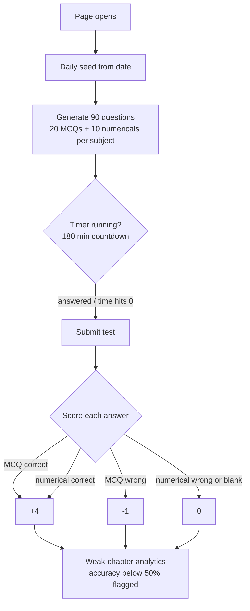

# JEE MAIN 2026 AI PRO MOCK

A single-file, no-dependency JEE Main mock test that runs entirely in the browser.

## What it does
- Generates a fresh 90-question paper (20 MCQs + 10 numericals per subject) across Physics, Chemistry and Maths, spread over real JEE chapters (Mechanics, Electrostatics, Calculus, Algebra, and more)
- Seeded by the date, so every day gets a different paper, and retaking on the same day gives the same one
- Standard JEE pattern: 180-minute countdown that auto-submits when it hits zero, +4 for a correct answer, -1 for a wrong MCQ
- Difficulty spread within each section: 7 Easy, 7 Moderate, 6 Hard MCQs, plus all-hard numericals
- Post-test analytics: final score out of 360 and a list of weak chapters (below 50% accuracy) so you know what to revise

## Run it
Open index.html in any browser. That's it. No build, no install, no backend.

## Structure
- index.html: the entire app (quiz generation, timer, scoring, and analytics)

## Flow

